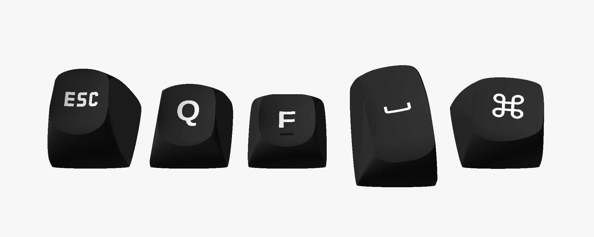

# Lily58-Tastenkappen (DES-Profil, deutsches Layout)

Tastenkappen für den [Lily58](https://github.com/kata0510/Lily58) mit deutschem Layout (QWERTZ,
ohne Sonderzeichen), Symbolen für die Sondertasten und mehrfarbigen Legenden. Die Kappen werden
von einem Skript aus parametrischen OpenSCAD-Vorlagen erzeugt und sind für den Druck auf einem
FDM-Drucker optimiert.

Die fertigen STL-Dateien für den DES-Satz liegen als ZIP am
[neuesten Release](../../releases/latest).




*Renderbilder aus OpenSCAD (Kappen mit plan geschnittenen Seiten, wie sie gedruckt werden; R1 um
180° gedreht, wie sie aufgesteckt wird).*

## Seitwärts gedruckt – optimiert für FDM

Die Kappen werden **auf der Seite liegend** gedruckt, nicht aufrecht:

- **Glatte Oberseite:** Die gewölbte Mulde entsteht aus senkrechten Schichtkonturen statt aus
  waagerechten Stufen. Aufrecht gedruckt zeichnet sich jede Schicht als Ring in der Mulde ab.
- **Stabiler Stem:** Die Schichtlinien laufen längs zum Stem. Aufrecht gedruckt verlaufen sie quer
  dazu, dort reißt der Stem beim Abziehen der Kappe am ehesten.
- **Flache Seiten:** Die linke und rechte Seitenwand ist entlang einer Ebene plan geschnitten
  (untere Randecke bis obere Kante). Jede Kappe liegt so mit 80 bis 240 mm² flach auf dem Bett.
  Der Druckwinkel ergibt sich aus derselben Ebene.
- **Herausziehbare Stütze:** Ein Fuß steht vor der offenen Unterseite der Kappe auf dem Bett, ein
  Steg reicht durch die Öffnung unter den Stem. Die Stütze berührt die Kappe nirgends
  (0,2 mm Abstand zum Stem, etwa 0,3 mm zur Wand) und lässt sich nach dem Druck herausziehen.
- **Mehrfarbige Legenden:** Beschriftung und Kappe sind getrennte Teile und werden mit zwei
  Filamenten gedruckt (z. B. mit dem AMS).

## Layout

| Reihe | Links | Rechts |
|---|---|---|
| R1 (Zahlen) | Esc 1 2 3 4 5 | 6 7 8 9 0 Entf |
| R2 | Tab Q W E R T | Z U I O P □ |
| R3 (Home) | Strg A S D **F** G | H **J** K L □ □ |
| R4 | Shift Y X C V B □ | □ N M □ □ □ Shift |
| Daumen | Alt GUI Lower Space | Enter Raise Backspace GUI |

□ = leere Kappe, **F**/**J** mit Homing-Steg. Space und Enter sind 1,5u. Strg, Alt und GUI tragen
die Mac-Symbole ⌃ ⌥ ⌘. Dazu kommen je Reihe eine leere Ersatzkappe, ein kompletter Satz leerer
Daumenkappen und zwei leere Homing-Kappen.

**R1 wird um 180° gedreht aufgesteckt:** Die R1-Kappe des DES-Profils ist nach hinten geneigt. Als
Zahlenreihe muss sie zum Nutzer zeigen, deshalb ist ihre Beschriftung um 180° gedreht.

## Drucken

- In Bambu Studio pro Gruppe `*_body.stl` und `*_legends.stl` zusammen importieren und als ein
  Objekt mit mehreren Teilen laden, dann der Legende das zweite Filament zuweisen. Leere Gruppen
  (`Ersatz_*`, `Daumen_leer`, `Homing_leer`) haben nur eine `*_body.stl`.
- Die Stützen sind schon enthalten, die Slicer-Stützen also ausschalten.
- Getestet mit einer 0,4-mm-Düse. Die Stem-Toleranz 0.025 sitzt fest; mit dem Modus `des-test`
  lassen sich andere Werte vorab testen.
- Empfehlungen: Naht nach hinten bzw. auf die Bettseite, Arachne als Wandgenerator (feine
  Symbollinien), Außenwände langsam.

## Selbst rendern

```bash
./lily58_keycaps.sh des-all            # DES-Satz, Standard-Toleranz 0.025
./lily58_keycaps.sh des-all 0.05       # andere Toleranz
./lily58_keycaps.sh des-test           # Passtest: leere Kappen mit 0.00 0.025 0.05 0.075
./lily58_keycaps.sh kat-all            # derselbe Satz im KAT-Profil (keycap_playground)
```

Die Ausgabe landet in `~/Documents/lily58_keycaps/stl/` (anderer Ort mit `KEYCAP_DIR=...`). Die
Vorlagen und Bibliotheken lädt das Skript beim ersten Lauf selbst herunter.

Voraussetzungen:

- OpenSCAD Nightly/Snapshot mit Manifold-Backend und `textmetrics` (zum Zentrieren der Legenden)
- `git` und `unzip`
- Schriften: JetBrains Mono Nerd Font (Bold) für die Symbole; Liberation Sans liegt OpenSCAD bei

## Änderungen an den Vorlagen

Die Vorlagen werden nicht verändert weiterverteilt. Das Skript lädt sie herunter und baut darauf auf.

### PseudoMakeMeKeyCapProfiles (DES, `MX_DES_Standard.scad`, `MX_DES_Thumb.scad`)

Das Skript nutzt eine Kopie der beiden Profildateien ohne ihren eigenen `keycap()`-Aufruf. Statt
`keycap()` baut ein eigenes Modul `des_cap()` die Kappe aus den Formfunktionen und Parametern des
Profils, mit diesen Änderungen:

- **Stem:** außen rund mit 5,7 statt 5,5 mm Durchmesser, Toleranz einstellbar (Standard 0.025).
- **Kreuzloch:** mit denselben Maßen neu aufgebaut, aber ohne deckungsgleiche Flächen, die beim
  Slicer-Import offene Kanten ergeben. Das Kreuz beginnt unterhalb des Stem-Bodens; die
  Einführschräge (1,1-fach bei z = 0) besteht aus zwei Pyramidenstümpfen pro Kreuzarm.
- **Mulde:** Die beiden Mulden-Hälften überlappen um 0,05 mm statt 0,00001 mm.
- **Legenden:** ein eigenes Teil für den Mehrfarbdruck, senkrecht zur geneigten Oberseite und nach
  der sichtbaren Form der Glyphe zentriert (`textmetrics`). Sie enden 0,3 mm über der Innendecke.
  Die R1-Legenden sind um 180° gedreht.
- **Homing:** ein erhabener Steg (3 × 1 mm, etwa 0,6 mm hoch) statt der Vertiefung des Originals.
- **Daumen:** High-Profile-Varianten (1,5u = ID 0, 1u = ID 1 und 2), für eine Hälfte gespiegelt; die
  Legenden bleiben dabei lesbar.
- **Druck:** Seiten plan geschnitten, auf die Seite gelegt, herausziehbare Stütze.
- **Auflösung:** `fn = 60`, `layers = 50`, die Werte, die der Autor für die Ausgabe nennt.

### keycap_playground (KAT, Modus `kat-all`)

Am Code des Playgrounds ändert das Skript nichts. Es setzt nur Parameter und verarbeitet die
erzeugten Kappen weiter:

- **Profil:** KAT mit den Reihen R1–R4.
- **Stem:** `round_cherry` mit 5,7 mm (`STEM_OUTSIDE_TOLERANCE_X = -0.23`).
- **Korrekturen pro Reihe:** `STEM_HEIGHT`, damit der runde Stem in hohen Reihen die Oberseite
  erreicht; `KEY_HEIGHT` und `HOMING_DOT_Z`, damit Legende und Homing-Punkt nicht unter der Mulde
  liegen; `LEGEND_TRANS` zentriert die Legende nach sichtbarer Form und auf der Oberseite statt auf
  der Grundfläche.
- **Wände:** keine Stem-Auskleidung (`STEM_SIDES_WALL_THICKNESS = 0`), dafür `WALL_THICKNESS = 1.8`.
- **Druck:** aufrecht rendern, Seiten plan schneiden, danach drehen; herausziehbare Stütze statt der
  eingebauten.

## Credits und Lizenzen

- **[PseudoMakeMeKeyCapProfiles](https://github.com/pseudoku/PseudoMakeMeKeyCapProfiles)** von
  pseudoku: DES-Profil (Distorted Elliptical Saddle), GPL-3.0. Das DES-Modul in
  `lily58_keycaps.sh` übernimmt Code daraus. Deshalb steht dieses Projekt ebenfalls unter GPL-3.0.
- **[keycap_playground](https://github.com/riskable/keycap_playground)** von Riskable:
  parametrischer Keycap-Generator, Grundlage des KAT-Modus. Das Repository nennt keine Lizenz. Das
  Skript lädt es deshalb nur zur Laufzeit herunter und verteilt weder seinen Code noch daraus
  erzeugte KAT-Kappen.
- **scad-utils** (Oskar Linde, MIT) sowie `skin.scad`/`sweep.scad` aus der `libraries.zip` des
  DES-Repositories; werden ebenfalls zur Laufzeit geladen.
- **Schriften** (nicht enthalten): Liberation Sans (SIL OFL 1.1); JetBrains Mono Nerd Font
  (JetBrains Mono: SIL OFL 1.1, Symbole aus dem Nerd-Fonts-Satz, u. a. Material Design Icons).
- **Lily58** von kata0510.

Dieses Projekt steht unter der **GNU General Public License v3.0**, siehe [LICENSE](LICENSE).
Das gilt auch für die im Release verteilten STL-Dateien des DES-Satzes.
