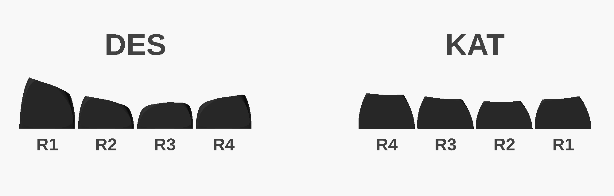
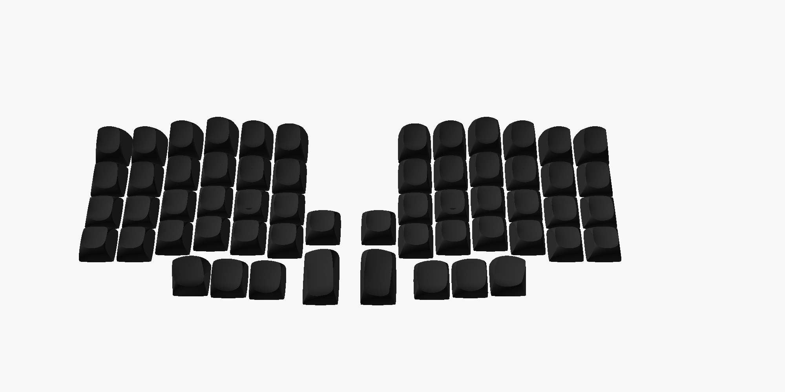
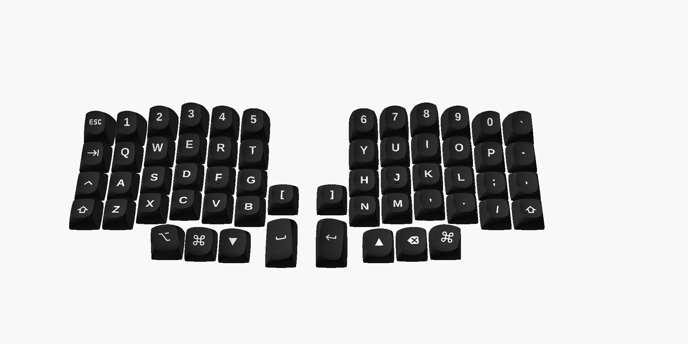
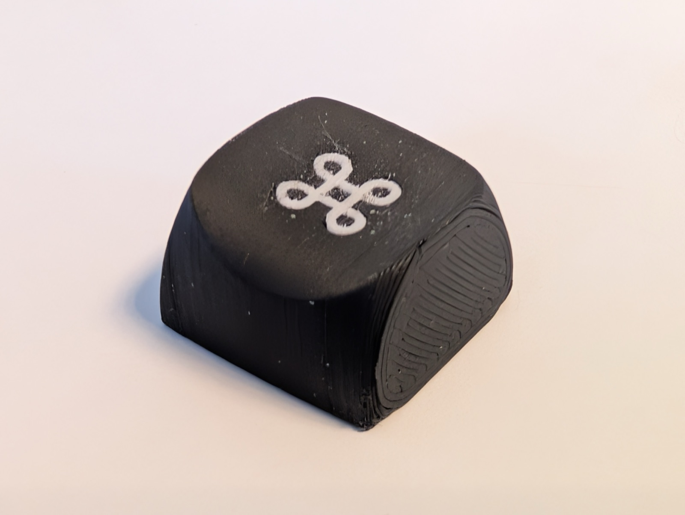
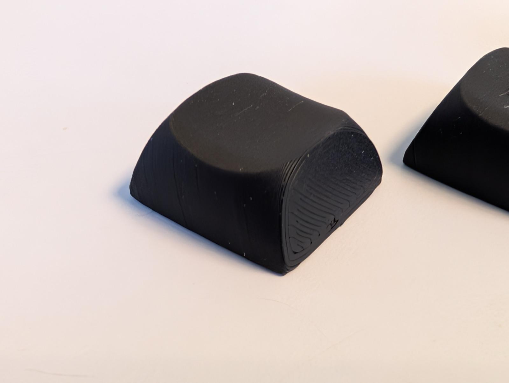
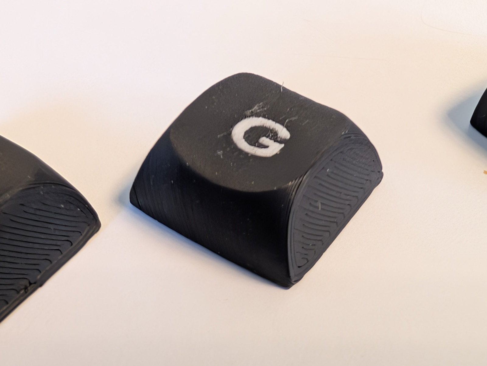
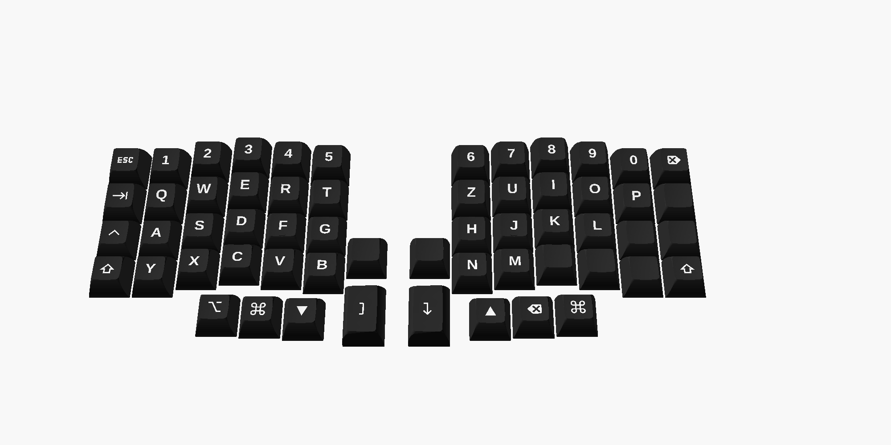
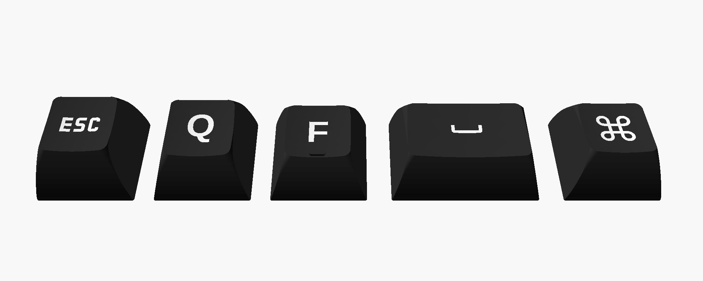

# Lily58 keycaps (DES and KAT profile, German and US layout)

Keycaps for the [Lily58](https://github.com/kata0510/Lily58) in two sculpted profiles – **DES** and
**KAT** – each with a German layout (QWERTZ, no special characters) or a US layout (QWERTY with
punctuation), symbols for the modifier keys and multi-color legends. The caps are generated by a
script from parametric OpenSCAD templates and are optimized for printing on an FDM printer.

The finished STL files are attached as ZIPs to the [latest release](../../releases/latest).

## Profiles



*Side view of one column as it sits on the keyboard (number row on the left, user on the right).*

- **DES** (Distorted Elliptical Saddle): strongly sculpted. The number row is tall and tilted
  towards the user, the home row is the lowest, the bottom row tilts away. The tops are deep
  saddle-shaped dishes.
- **KAT**: noticeably flatter, with a moderate row sculpt and spherical dishes.

## DES







**R1 is mounted rotated by 180°:** the R1 cap of the DES profile tilts backwards. As the number row
it has to face the user, so its legends are rotated by 180°.

Printed DES caps (0.4 mm nozzle, two filaments). The flat side on the right of each cap is the side
that lay on the print bed:

| | | |
|---|---|---|
|  |  |  |

## KAT







The KAT 1.5u caps are built as regular (horizontal) 1.5u keys; on the Lily58 the switch is rotated,
so they sit upright and their symbol appears sideways. In the KAT files the rows are named after
the profile: R4 = number row, R3 = top row, R2 = home row, R1 = bottom row and thumbs.

*All pictures above except the photos are OpenSCAD renders of the caps with flattened sides, as
they are printed.*

## Printed sideways – optimized for FDM

The caps are printed **lying on their side**, not upright:

- **Smooth top surface:** the curved dish is built from vertical layer contours instead of
  horizontal steps. Printed upright, every layer shows up as a ring in the dish.
- **Stronger stem:** the layer lines run along the stem. Printed upright they run across it, which
  is where the stem tends to break when the cap is pulled off.
- **Flat sides:** the left and right side walls are cut flat along a plane (from the bottom rim
  corner to the top edge). Each cap lies flat on the bed with 80 to 240 mm² of contact; the print
  angle follows from the same plane.
- **Removable support:** a foot stands on the bed in front of the open bottom of the cap, a fin
  reaches through the opening under the stem. The support does not touch the cap anywhere (0.2 mm
  gap to the stem, about 0.3 mm to the wall) and is simply pulled out after printing.
- **Multi-color legends:** legend and cap are separate parts and are printed with two filaments
  (e.g. with the AMS).

## Layout

German layout:

| Row | Left | Right |
|---|---|---|
| Numbers | Esc 1 2 3 4 5 | 6 7 8 9 0 Del |
| Top | Tab Q W E R T | Z U I O P □ |
| Home | Ctrl A S D **F** G | H **J** K L □ □ |
| Bottom | Shift Y X C V B □ | □ N M □ □ □ Shift |
| Thumbs | Alt GUI Lower Space | Enter Raise Backspace GUI |

US layout (follows the Lily58 default keymap):

| Row | Left | Right |
|---|---|---|
| Numbers | Esc 1 2 3 4 5 | 6 7 8 9 0 \` |
| Top | Tab Q W E R T | Y U I O P - |
| Home | Ctrl A S D **F** G | H **J** K L ; ' |
| Bottom | Shift Z X C V B [ | ] N M , . / Shift |
| Thumbs | Alt GUI Lower Space | Enter Raise Backspace GUI |

□ = blank cap, **F**/**J** with homing bar or dot. Space and Enter are 1.5u. Ctrl, Alt and GUI use
the Mac symbols ⌃ ⌥ ⌘. Every set also contains one blank spare cap per row, a full set of blank
thumb caps and two blank homing caps.

## Printing

- In Bambu Studio, import `*_body.stl` and `*_legends.stl` of a group together and load them as one
  object with multiple parts, then assign the second filament to the legend. Blank groups
  (`Ersatz_*`, `Daumen_leer`, `Homing_leer`) only have a `*_body.stl`.
- The supports are already included, so turn slicer supports off.
- Stem fit with a 0.4 mm nozzle: DES uses a tolerance of 0.025 (tested, firm fit). DES and KAT
  apply the tolerance differently, so the values are not interchangeable; print a fit test first
  with `des-test` / `kat-test`.
- Recommended: seam at the back or on the bed side, Arachne wall generator (fine symbol lines),
  slow outer walls.

File names are German: `links`/`rechts` = left/right half, `Daumen` = thumbs, `Ersatz` = spare,
`leer` = blank, `Passtest` = fit test.

## Rendering yourself

```bash
./lily58_keycaps.sh des-all            # DES set (German), default tolerance 0.025
LAYOUT=us ./lily58_keycaps.sh des-all  # DES set with US layout
./lily58_keycaps.sh des-all 0.05       # different tolerance
./lily58_keycaps.sh des-test           # DES fit test: blank caps with 0.00 0.025 0.05 0.075
./lily58_keycaps.sh kat-all            # KAT set (German), default tolerance 0.20
LAYOUT=us ./lily58_keycaps.sh kat-all  # KAT set with US layout
./lily58_keycaps.sh kat-test           # KAT fit test: blank caps with 0.025 0.05 0.075 0.10
```

The output goes to `~/Documents/lily58_keycaps/stl/` (set another location with `KEYCAP_DIR=...`).
The script downloads the templates and libraries itself on the first run.

Requirements:

- OpenSCAD nightly/snapshot with the Manifold backend and `textmetrics` (used to center legends)
- `git` and `unzip`
- Fonts: JetBrains Mono Nerd Font (Bold) for the symbols; Liberation Sans ships with OpenSCAD

## Changes to the templates

The templates are not redistributed in modified form; the script downloads them and builds on them.

### PseudoMakeMeKeyCapProfiles (DES, `MX_DES_Standard.scad`, `MX_DES_Thumb.scad`)

The script uses a copy of both profile files without their own `keycap()` call. Instead of
`keycap()`, a custom module `des_cap()` builds the cap from the profile's shape functions and
parameters, with these changes:

- **Stem:** round outside with a diameter of 5.7 instead of 5.5 mm, adjustable tolerance
  (default 0.025).
- **Cross hole:** rebuilt with the same dimensions but without coincident faces, which cause open
  edges on slicer import. The cross starts below the stem bottom; the entry chamfer (1.1× at z = 0)
  is made of two frustums per cross arm.
- **Dish:** the two dish halves overlap by 0.05 mm instead of 0.00001 mm.
- **Legends:** a separate part for multi-color printing, perpendicular to the tilted top and
  centered on the visible shape of the glyph (`textmetrics`). They end 0.3 mm above the inner
  ceiling. The R1 legends are rotated by 180°.
- **Homing:** a raised bar (3 × 1 mm, about 0.6 mm high) instead of the original's dimple.
- **Thumbs:** high-profile variants (1.5u = ID 0, 1u = IDs 1 and 2), mirrored for one half; the
  legends stay readable.
- **Printing:** sides cut flat, laid on the side, removable support.
- **Resolution:** `fn = 60`, `layers = 50`, the values the author gives for output.

### keycap_playground (KAT, modes `kat-all` and `kat-test`)

The script does not change the playground's code; it only sets parameters and post-processes the
generated caps:

- **Profile:** KAT with rows R1–R4.
- **Stem:** `round_cherry` with 5.7 mm (`STEM_OUTSIDE_TOLERANCE_X = -0.23`).
- **Per-row fixes:** `STEM_HEIGHT`, so the round stem reaches the top in tall rows; `KEY_HEIGHT` and
  `HOMING_DOT_Z`, so legend and homing dot do not end up below the dish; `LEGEND_TRANS` centers the
  legend on its visible shape and on the top instead of the base.
- **Walls:** no stem lining (`STEM_SIDES_WALL_THICKNESS = 0`), `WALL_THICKNESS = 1.8` instead.
- **Printing:** render upright, cut the sides flat, then rotate; removable support instead of the
  built-in one.

## Credits and licenses

- **[PseudoMakeMeKeyCapProfiles](https://github.com/pseudoku/PseudoMakeMeKeyCapProfiles)** by
  pseudoku: DES profile (Distorted Elliptical Saddle), GPL-3.0. The DES module in
  `lily58_keycaps.sh` contains code derived from it, which is why this project is GPL-3.0 as well.
- **[keycap_playground](https://github.com/riskable/keycap_playground)** by Riskable: parametric
  keycap generator, basis of the KAT caps. Its code is not part of this repository; the script
  downloads it at runtime. The keycap_playground repository does not state a license. The KAT caps
  in the release are generated with it and published with attribution – if you are the author and
  do not agree with this, please open an issue and they will be removed.
- **scad-utils** (Oskar Linde, MIT) and `skin.scad`/`sweep.scad` from the `libraries.zip` of the DES
  repository; also loaded at runtime.
- **Fonts** (not included): Liberation Sans (SIL OFL 1.1); JetBrains Mono Nerd Font (JetBrains Mono:
  SIL OFL 1.1, symbols from the Nerd Fonts set, including Material Design Icons).
- **Lily58** by kata0510.

This project is licensed under the **GNU General Public License v3.0**, see [LICENSE](LICENSE).
This also applies to the DES STL files distributed in the release; for the KAT STL files see the
note on keycap_playground above.
